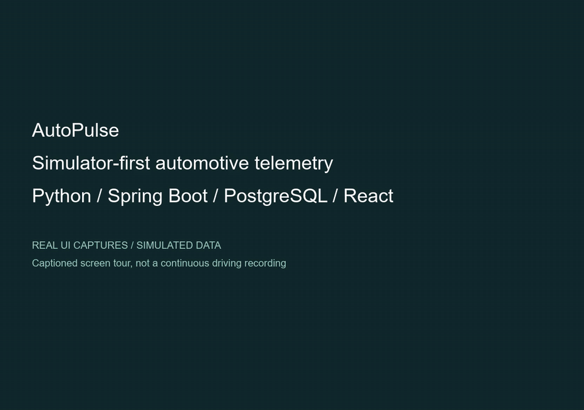

# AutoPulse

**Simulator-first automotive telemetry, trip analytics, and evidence-backed maintenance context.**

[](https://github.com/afa000/AutoPulse/actions/workflows/verify.yml)

AutoPulse connects a Python vehicle simulator to a Spring Boot API, PostgreSQL, and a React/TypeScript dashboard. It handles duplicate delivery, delayed observations, missing sensors, and backend recovery without presenting incomplete data as vehicle health.

**Status:** working local software prototype. Live telemetry, trips/history, diagnostics, and manual maintenance workflows are implemented and tested with simulated data. Physical OBD-II integration, durable edge buffering, authentication, and deployment remain planned.

## Short demo



[Watch/download the 36-second MP4](docs/demo/autopulse-demo.mp4) · [Transcript, provenance, and reproduction](docs/demo/README.md)

This captioned screen tour uses real captures from isolated browser demos, not a continuous driving recording. Telemetry and diagnostic observations are **SIMULATED**; service records are demonstration fixtures. No vehicle hardware is connected.

## What works today

- **Live dashboard:** committed latest state over Server-Sent Events, reconnect behavior, explicit measurement age, and separate connection/freshness indicators. Missing values stay unavailable, not zero.
- **Trips and history:** deterministic trip boundaries, estimated distance with coverage, sensor summaries, UTC charts, bounded paging, and explicit raw-expiry versus retained-aggregate availability.
- **Diagnostic observations:** durable snapshots, scoped code cycles and recurrence, complete/partial/unsupported outcomes, and a small provenance-backed generic-code catalog with an unknown-definition fallback.
- **Maintenance context:** manual service/odometer history, revisioned corrections, explicitly selected schedules, versioned evidence-backed advisories, and retry-safe form submissions.
- **Reliability:** precise decimal wire data, idempotent ingestion and original receipts, durable backend work, restart/replay tests, and diagnostic retry ordering that prevents failed work being skipped.

## Architecture

```text
Python simulator / device-agent contracts
               |
               | bounded HTTP/JSON batches and diagnostic snapshots
               v
Java 21 / Spring Boot -- JDBC / Flyway --> PostgreSQL 17
               |
               | HTTP history + current-state SSE
               v
React / TypeScript / Vite dashboard
```

Local development uses loopback HTTP. Authentication, TLS, production hosting, and a physical adapter are not implemented. SSE coalesces current state; it is not a durable event log. JSONL capture/replay is not a crash-safe device outbox.

## Try it without hardware

Prerequisites: Python 3.12+, Java 21, Docker Desktop/Engine, Node 24.15+ (24.x), and npm 11. The Maven wrapper is included.

From the repository root in PowerShell:

```powershell
py -3.12 -m venv device-agent/.venv
./device-agent/.venv/Scripts/python.exe -m pip install -e "./device-agent[dev]"
./device-agent/.venv/Scripts/python.exe -m autopulse_agent.simulate --scenario normal-commute
```

The preview is offline: no vehicle, server, or database needed.

For the web application, follow the [local development guide](docs/local-development.md). For an isolated end-to-end demonstration, install the frontend/browser prerequisites, then run:

```powershell
Push-Location web
npm ci
npm exec -- playwright install chromium
Pop-Location
Push-Location server
./mvnw.cmd test "-Dtest=CareMilestoneDemo" "-Dautopulse.python=../device-agent/.venv/Scripts/python.exe"
Pop-Location
```

Docker must be running. This demo creates its own PostgreSQL container and temporary capture, exercises the actual Python sender/backend/UI across a backend process restart, and cleans up afterward. Do not start Compose or use an existing development database for isolated tests. On Linux/macOS, use `bash ./mvnw` and an absolute path to the installed Python executable.

## Verification

GitHub Actions tests Python 3.12 and 3.14, the backend against real disposable PostgreSQL, and the frontend plus integrated Chromium demos.

Latest local verification on October 24, 2026:

| Check | Result |
| --- | --- |
| Python 3.12 and 3.14 | 176 tests on each |
| Java/PostgreSQL | 463 tests, including five diagnostic recovery regressions |
| Frontend | 104 tests; typecheck, lint, and production build |
| Care browser demonstrations | Three scenarios through the real API/database/UI |

Other integrated checks cover large/signed analytical totals, trip crash/replay/retention, and live reconnect behavior. The [verification record](docs/milestone-verification.md) contains commands, historical runs, and coverage boundaries. Counts are a snapshot, not a performance or production-readiness claim; the linked workflow is the source for hosted results.

Run all local gates after installing dependencies:

```powershell
./scripts/verify.ps1 -Python ./device-agent/.venv/Scripts/python.exe -Browser
```

## Safety and limitations

- **No ECU controls:** no code clearing, reset, coding, actuation, or arbitrary vehicle-command endpoints. The current source boundary is logical/read-only; physical adapter safety has not yet been validated.
- **Not a diagnosis:** an observation does not prove a failed part, repair, or driving safety. Synthetic temperature thresholds are not Hyundai specifications.
- **Manual maintenance context:** supported oil/filter rules carry manufacturer-document provenance and applicability conditions. Normal/severe usage is explicitly selected; missing history and stale inputs do not establish up-to-date service.
- **Local/private application:** vehicle-scoped routes are not authentication. Do not expose the development servers to the internet.
- **Conservative defaults:** trip, diagnostic, and maintenance workers are opt-in. Retention is off and dry-run is on; no automatic diagnostic/service deletion exists. Backend startup may apply migrations to its configured database.
- **Not compact archival storage:** protected evidence and full canonical replay data remain. Raw cleanup is explicit, bounded, and guarded.
- **Hardware is future work:** the intended Raspberry Pi + USB OBD-II path for a 2021 Hyundai Venue has not been tested on the vehicle.

## Repository guide

| Path | Purpose |
| --- | --- |
| `device-agent/` | Python simulator, source contracts, codecs, HTTP transport, capture/replay |
| `server/` | Spring Boot API, persistence, trip/diagnostic/maintenance processing, migrations |
| `web/` | React dashboard and browser tests |
| `contracts/` | OpenAPI schemas and shared valid/invalid fixtures |
| `docs/adr/` | Architecture decisions and evidence/precision policies |
| `scripts/` | Verification and isolated demonstration helpers |

[Local setup](docs/local-development.md) · [API contract](contracts/openapi.yaml) · [Trip/retention operations](docs/trip-processing-operations.md) · [Maintenance operations](docs/maintenance-operations.md) · [Architecture decisions](docs/adr)

## Next milestones

Durable device buffering/reconnect recovery; read-only physical adapter validation; authentication/authorization and production deployment safeguards. These are not included in the current prototype.

## License

No project-wide license has been selected. Referenced manufacturer documents retain their own rights; catalog-specific notices do not license the whole repository.
